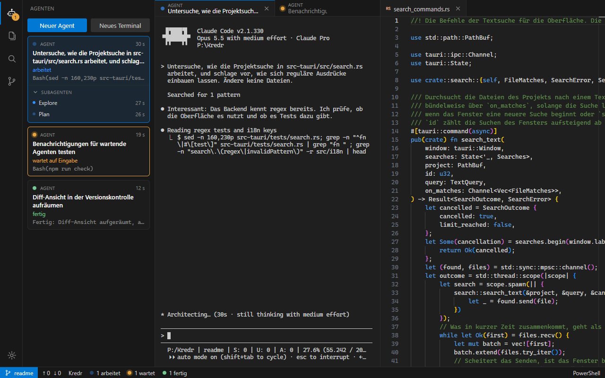

<div align="center">


# Kredr

**A lightweight workbench for Claude Code agents on Windows.**

Run several agents in terminals, browse your projects' files and commit changes – in one window, without the weight of a full-blown editor.

[](https://github.com/SirKashij/Kredr/actions/workflows/pruefen.yml)
[](https://github.com/SirKashij/Kredr/releases)


[Download](https://github.com/SirKashij/Kredr/releases/latest) · [Features](#features) · [Keyboard shortcuts](#keyboard-shortcuts) · [Development](#development) · [Report a bug](https://github.com/SirKashij/Kredr/issues)

</div>

<br>



---

## Why Kredr?

Working with several Claude Code agents at once quickly turns into juggling terminal windows and losing track of which agent is working, which one is done and which one is waiting for an answer. Kredr brings all of that into one place:

- **Keep an eye on your agents.** The agents view shows for every terminal whether its agent is working, done or waiting for input – including its subagents.
- **Never miss a question.** When an agent is waiting, Kredr tells you with a Windows notification and the taskbar icon. One click takes you straight to the right tab.
- **Several projects, one window.** Combine projects into a workspace: one explorer, one search, version control for every repository, and agents grouped by project.
- **Pick up where you left off.** Close a window and your agents come back in the same place with their conversations the next time you open it – even after restarting your computer.
- **Fast and lean.** Kredr is built on [Tauri](https://tauri.app) and the WebView2 that ships with Windows instead of Electron ([ADR 0001](docs/adr/0001-tauri-statt-electron.md)).

## Features

### Agents and terminals

- Start new agents with a shortcut (`Ctrl+Shift+A`) or terminals running PowerShell or Git Bash (`` Ctrl+Shift+` ``)
- Agent status comes from Claude Code hooks – Kredr never reads or changes your Claude Code settings
- Subagents appear below their agent, their questions right in their row
- The task (the first prompt) is shown on the tab as long as the terminal has no name of its own
- Terminal based on [xterm.js](https://xtermjs.org) with WebGL rendering

### Workspaces

- Add more projects to a window and it becomes a workspace, like a multi-root workspace in VS Code ([ADR 0004](docs/adr/0004-workspaces-intern-ohne-zusammenfuehren.md))
- Rename workspaces, reorder their projects, or drag a folder from Windows Explorer onto the sidebar to add it
- The agents view groups agents and terminals by project; terminals started elsewhere appear under “Outside the Projects”
- The status bar and the branch list follow the project of the active tab
- Workspaces show up next to projects in the recent list on the start page and reopen with their layout and agents

### Main area

- Split freely into groups with their own tab bar, to the right and downwards
- The layout, including names, start folders and conversations, is saved per project and per workspace and restored on opening
- Tabs with the same name from different projects carry the project name
- A project is open in exactly one window; open as many windows as you like

### Files

- Explorer with Git colors, quick open (`Ctrl+P`) and search across all projects of the window
- File view with syntax highlighting and simple edits, based on [Monaco](https://microsoft.github.io/monaco-editor/)
- Markdown preview and image viewer
- Preview tabs for quickly browsing files

### Version control

- Review, stage and commit changes
- Several repositories side by side in a workspace, each with its own commit box and sync
- Diff view, commit history and branches
- Sync with GitHub

### Windows integration

- “Open with Kredr” in the Explorer context menu
- The `kredr .` command opens the current folder as a project from any terminal
- User interface in English and German

## Installation

1. Download the installer `Kredr_<version>_x64-setup.exe` from the [releases page](https://github.com/SirKashij/Kredr/releases/latest).
2. Run it. Kredr is installed for the current user, no administrator rights required.

The installer adds “Open with Kredr” to the Explorer context menu and a folder with the `kredr` command to your user `PATH`. Uninstalling Kredr (Windows Settings → Apps) removes both again.

> [!NOTE]
> The installer is not signed, so Windows SmartScreen shows a warning on first launch. Click “More info” → “Run anyway” to start it.

### Requirements

| What | Why |
| --- | --- |
| Windows 11 | Kredr runs on Windows 11 only. |
| [Claude Code](https://docs.claude.com/claude-code) | “New Agent”. The start command can be changed in the settings. |
| [Git](https://git-scm.com/download/win) | Version control and Git Bash. Everything else works without Git. |

## Keyboard shortcuts

The shortcuts follow the default VS Code shortcuts on Windows.

| Shortcut | Action |
| --- | --- |
| `Ctrl+Shift+A` | New agent |
| `` Ctrl+Shift+` `` | New terminal |
| `Ctrl+P` | Quick open file |
| `Ctrl+B` | Toggle sidebar |
| `Ctrl+Shift+E` / `F` / `G` | Explorer / Search / Version control |
| `Ctrl+\` | Split right |
| `Ctrl+K`, `Ctrl+\` | Split down |
| `Ctrl+1` … `Ctrl+8` | Go to group 1 to 8 |
| `Ctrl+K`, `Ctrl+Arrow` | Go to the group in that direction |
| `Alt+Arrow` | Next / previous group |
| `Ctrl+Tab` / `Ctrl+PgDn` | Next tab |
| `Ctrl+Shift+Tab` / `Ctrl+PgUp` | Previous tab |
| `Ctrl+W` / `Ctrl+F4` | Close tab |
| `Ctrl+,` | Settings |

## Development

### Prerequisites

- [Node.js](https://nodejs.org) 24
- [Rust](https://rustup.rs) (stable) with `rustfmt` and `clippy`
- The [Tauri prerequisites for Windows](https://tauri.app/start/prerequisites/) (Microsoft C++ Build Tools, WebView2)

### Commands

```powershell
git clone https://github.com/SirKashij/Kredr.git
cd Kredr
npm install

npm run tauri dev     # start in development mode
npm run check         # check everything like CI: formatting, types, tests, build, clippy
npm run format        # format frontend and core
npm run tauri build   # build the installer (src-tauri/target/release/bundle/nsis/)
```

> [!TIP]
> If the PowerShell execution policy blocks `npm.ps1`, use `npm.cmd` instead of `npm`.

### Structure

| Folder | Contents |
| --- | --- |
| [`src/`](src) | Frontend: React 19, TypeScript, Vite, Vitest |
| [`src-tauri/`](src-tauri) | Core: Rust and Tauri 2 – terminals, agent status, project files, version control, workspaces |
| [`docs/adr/`](docs/adr) | Architecture decision records |
| [`GLOSSARY.md`](GLOSSARY.md) | The terms used by the code, the UI and the issues |

Code comments, commit messages, issues and the documents in `docs/` are written in German.

## Contributing

Bug reports and feature requests are welcome in the [issues](https://github.com/SirKashij/Kredr/issues). For now I don't accept pull requests, as long as Kredr has no license (see [License](#license)).

## Acknowledgements

Kredr stands on the shoulders of [Tauri](https://tauri.app), [xterm.js](https://xtermjs.org), [Monaco](https://microsoft.github.io/monaco-editor/), [portable-pty](https://github.com/wezterm/wezterm/tree/main/pty) and [ripgrep](https://github.com/BurntSushi/ripgrep) (`ignore`, `grep-searcher`). All included packages and their licenses are listed in Kredr under Settings → Third-party licenses; `npm run build` collects them in `dist/THIRD_PARTY_LICENSES.txt`.

## Security

Please report vulnerabilities privately, not as public issues. See [SECURITY.md](SECURITY.md).

## License

Kredr is currently not released under an open source license; all rights reserved. You may use the published installers and read the source code. Modifying, redistributing or using the code in your own projects is not permitted without permission.
